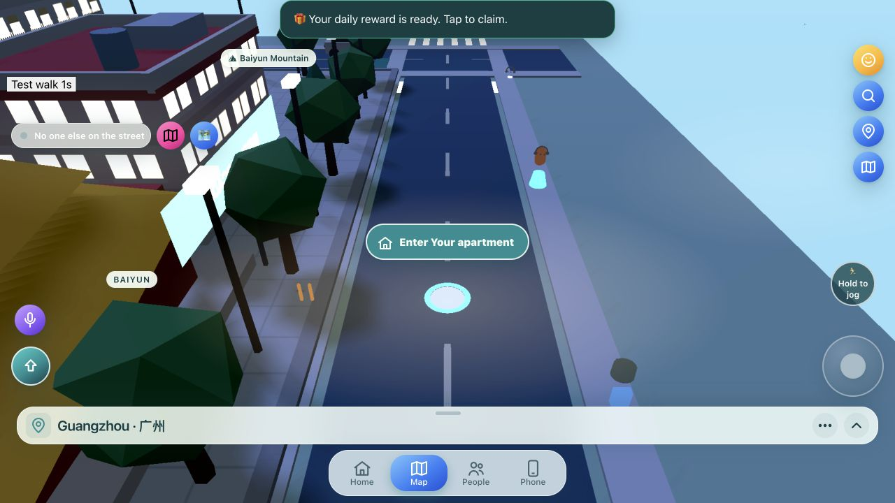
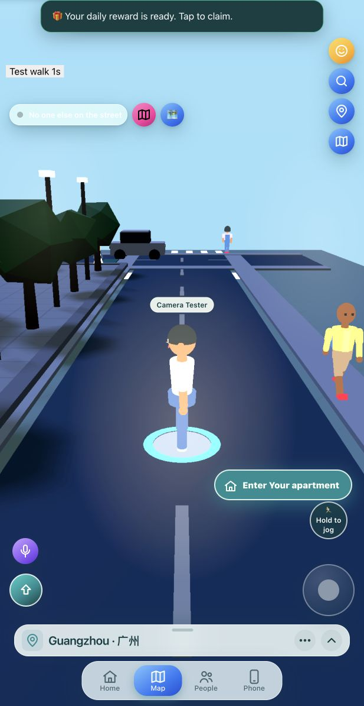
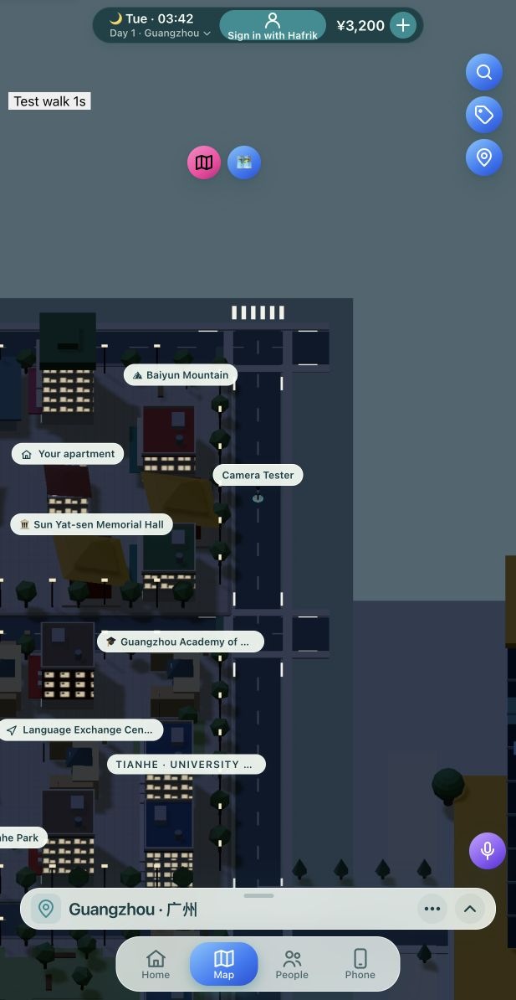

# Guangzhou street camera — Phase 1

Status: local prototype awaiting acceptance; Phase 2 has not started. Branch: `codex/guangzhou-camera-foundation`, based on `d1e5f14`. Nothing deployed or pushed.

## Audit findings (before implementation)

1. **Cameras.** `world.js` already selects between an orthographic map camera, a perspective follow camera and a driving camera. The existing Street/Map control operates on the same scene. The street camera used FOV 55, a fixed 9.5-unit distance and a minimum pitch of .62 radians. Pinch and wheel changed map scale, which the street camera ignored. Direction following rounded to cardinal headings.
2. **Movement.** The render loop advances a target at 3.9 units/second walking or 6.4 jogging. Camera-relative joystick/WASD input feeds that target; `lifeFrame` supplies procedural limb animation and `turnTo` turns the body. Fixed animation frequency is independent of actual distance travelled, so foot sliding remains a Phase 2 concern. A second legacy keyboard handler also exists and should be consolidated in Phase 2.
3. **Coordinates.** `city-layout.js` combines shared `GRID` coordinates, city overrides and content positions from `map-data.js`. Entrances project onto the nearest street, with a special HQ entrance. `streetRoute` routes through grid intersections. `onStreet` restricts movement to strips within 2.9 units of road axes; this is not precise collision against buildings, stalls, trees or traffic. Venue collisions use separate room obstacles and `movement.js`.
4. **Multiplayer.** `cloud.js` publishes street `x`, `z`, heading and optional emote through existing presence POSTs. The regular heartbeat is 20 seconds; walking near peers permits 4 seconds, with light position refreshes and existing room-change updates. `streetFrame` already interpolates at most 30 nearby avatars. No polling changes are needed for this phase. Sparse samples cannot reproduce every intermediate direction change.
5. **Scale and visibility.** The character factory builds roughly two-unit models, drawn at .8 scale: approximately 1.6 units high. Existing doors are approximately 1.8 units, with seats around .49. This is a stylized scale, not a city-wide metre standard. Keep these dimensions for now; globally enlarging characters to 1.8 would affect doors and furniture. Close-camera framing and the entrance prompt also affect perceived size. Browser QA uncovered a separate visibility problem involving reused character geometry buffers; owned geometry copies restore the prototype player's rendering.
6. **Compatibility/performance.** Cached city groups, static mesh merging, instancing, shadow reuse, native Three.js frustum culling and adaptive pixel ratio already exist. Preserve them. Box-only camera collision gives false positives because merged meshes span empty streets; exact mesh probes are needed after a broad phase. Their CPU cost must be checked on phones. Current static bounds exclude small/low objects. Remote avatar geometry ownership and cleanup deserve a wider audit in Phase 4.

`public/venue-scenes.js` does not exist in this revision. Interiors are built through `world.js`, `models.js`, `home-interiors.js`, `rooms.js`, club modules and related helpers. This implementation reuses those paths and `game.walkIn`; it does not introduce an interior engine.

## Implemented

- Guangzhou street mode only: FOV 70, default distance 5.5 units, independently adjustable 4–7-unit pinch/wheel zoom, and separate street pitch. Initial camera height is approximately 2.9 units with the existing ground/character scale.
- Smooth focus and position tracking; forward movement follows the character heading without cardinal rounding. Drag rotation remains available.
- Cached broad-phase bounds followed by exact mesh intersections on the final interpolated camera position. Obstructions retract the lens with clearance instead of enforcing the old 2.4-unit minimum. Recovery uses the existing interpolation.
- The local Guangzhou street avatar gets geometry copies once per scene, sharing those copies between identical parts. Existing scene cleanup disposes them; repeated Street/Map toggles do not clone again.
- Reuse the existing Street/Map control. Switching cancels held movement input and retains the player object and position. The nearby entrance prompt moves away from the character only in this prototype mode.
- Keep the approved overhead scene geometry, lighting, city layouts and labels. No city/building model restyling. Character dimensions, backend APIs, save formats, voice integration and presence intervals remain unchanged.
- Fix `build-r1.mjs` URL decoding so bundling works in a workspace path containing spaces. Rebuild hashed app/CSS assets and their existing HTML references.
- Make the existing render benchmark use the active camera instead of always benchmarking the orthographic camera.

## Verification

`node scripts/build-r1.mjs`: passes.

`node --test tests/street-camera.mjs`: 6/6 pass. Covers wall retraction below the old camera minimum, clear paths, false-positive merged bounds, city/mode gating, position retention and input reset on toggles, and one-time geometry ownership without mutating shared models.

`npm test`: **332 tests pass, 0 failures, 0 skipped** after the regression repair. `npm run lint:php` also passes. The initial untouched baseline at `d1e5f14` had 89 failures; the test harness and obsolete expectations are now repaired, alongside the gameplay/cache bugs that the repaired tests exposed. See [the repair report](TEST-REPAIR-2026-10-20.md).

Browser checks used a disposable local Guangzhou Worker save at street entrance `(-50, 0, -48)`, without signing in. The local fixture suppresses the login modal and adds a test walking button; those fixture changes are outside the repository and are not shipped. The screenshots are development evidence, not production multiplayer acceptance.

- Character now renders with normal depth testing; geometry and model scale match the existing world.
- Continuous camera-relative walking exercised with a one-second held input.
- Street → Map → Street preserves `(-50, 0, -48)` without navigation/reload; overhead map remains available.
- Tested desktop 1280×720 and a narrow 617×1194 browser layout. Physical Android/iPhone touch gestures, device memory usage, voice and authenticated two-player sessions remain unverified. A narrow desktop browser is not a phone performance measurement.

## Performance snapshot

Same local position, desktop host, narrow 617×1194 layout, pixel ratio 1.5:

| Measurement | Before | After |
| --- | ---: | ---: |
| Reported animation FPS at capture | 107 | 108 |
| Triangles reported by existing stats | 101,476 | 97,574 |
| Draw calls at capture | 225 | 162 |
| After-only render benchmark, 30 frames | — | 1.65 ms/frame |

These are snapshots with animated traffic/pedestrians, different FOVs and frustum contents. They do not establish an optimization percentage. The render benchmark includes forced shadow rendering and a GPU readback, but excludes the full simulation/input/network workload. Its estimated FPS is not gameplay FPS. The baseline benchmark used the wrong camera, so its timing is deliberately omitted. No 30 FPS phone claim or memory improvement is made.

Raw capture: [metrics.json](qa/guangzhou-phase1/metrics.json).

Before:

After:

Map switch:

## Acceptance remaining

The automated suite is green. Verify pinch, joystick, camera rotation, sustained frame time and memory on physical Android and iPhone. Validate authenticated peers, voice and venue entry on a test server. Inspect camera clearance around nearby Guangzhou buildings and thin/low obstructions. These checks and owner acceptance precede Phase 2; do not expand to other cities yet.
